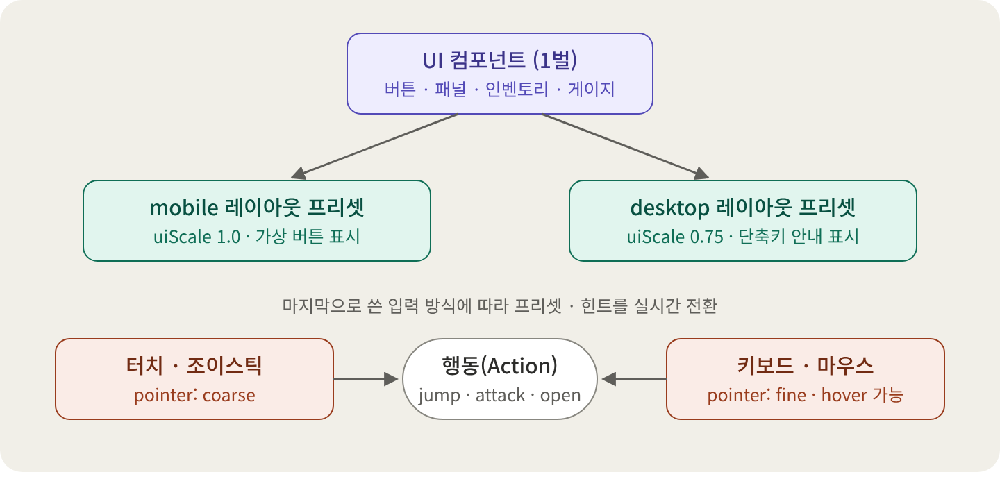
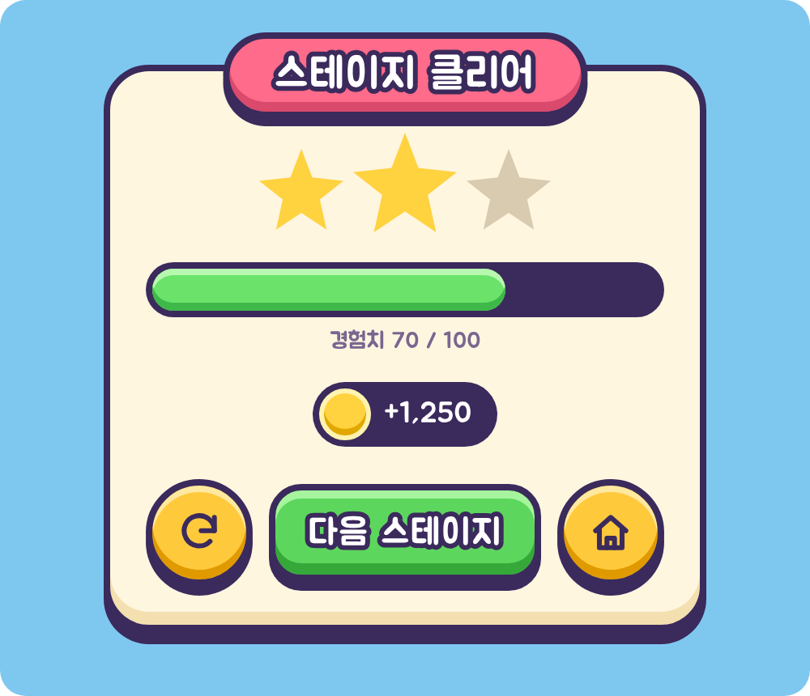
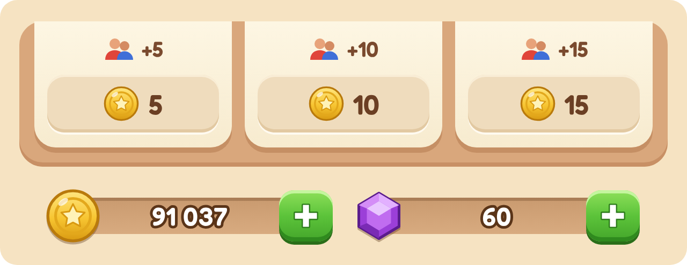
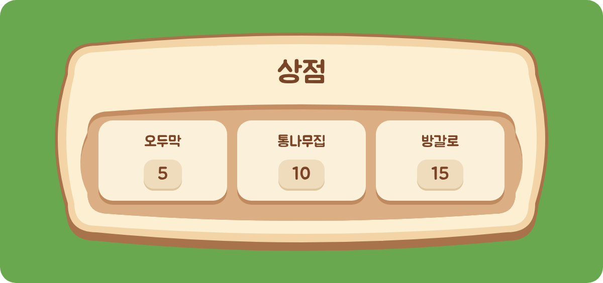
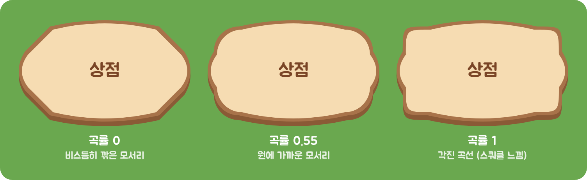
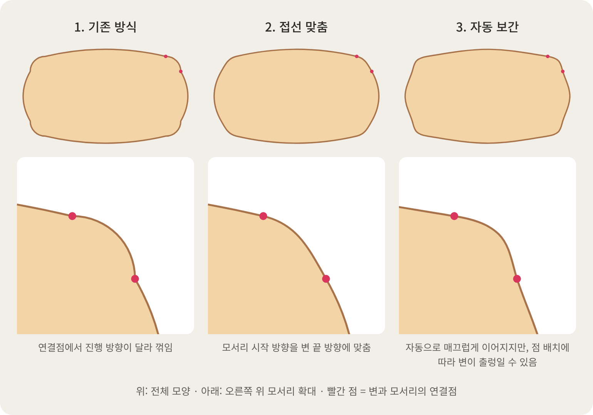
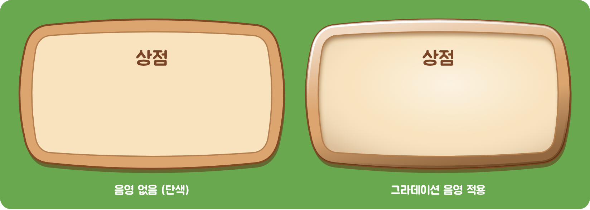
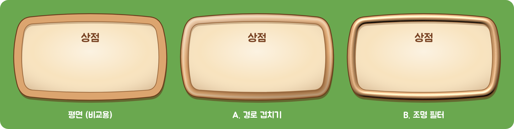

# 웹 게임 UI 설계 노트: 카툰풍 UI를 코드로 만들기

> PC/모바일 크로스 플랫폼 웹 게임 개발 중 나눈 대화를 주제별로 정리한 문서입니다.
> 이미지는 모두 대화 속 데모를 실제로 렌더링한 것이며 `images/` 폴더에 들어 있습니다.
> 정리일: 2026-11-26

## 목차

1. [PC/모바일 UI 통일 전략](#1-pc모바일-ui-통일-전략)
2. [무료 UI 디자인·에셋 사이트](#2-무료-ui-디자인에셋-사이트)
3. [CSS만으로 만드는 카툰풍 UI](#3-css만으로-만드는-카툰풍-ui)
4. [상점 UI 스타일 재현 (CSS + SVG)](#4-상점-ui-스타일-재현-css--svg)
5. [통일된 에셋을 위한 AI 도구](#5-통일된-에셋을-위한-ai-도구)
6. [변이 볼록한 판 만들기](#6-변이-볼록한-판-만들기)
7. [clip-path 하나로 변과 모서리 제어하기](#7-clip-path-하나로-변과-모서리-제어하기)
8. [리소스 비교: 이미지 vs clip-path vs SVG](#8-리소스-비교-이미지-vs-clip-path-vs-svg)
9. [변과 모서리 연결점 매끄럽게 만들기](#9-변과-모서리-연결점-매끄럽게-만들기)
10. [그라데이션 음영으로 입체감 주기](#10-그라데이션-음영으로-입체감-주기)
11. [원기둥 형태의 양각 프레임](#11-원기둥-형태의-양각-프레임)
12. [Xeon E5-2667 v4에서의 성능](#12-xeon-e5-2667-v4에서의-성능)
13. [부록: 핵심 코드](#13-부록-핵심-코드)
14. [참고 링크](#14-참고-링크)

---

## 1. PC/모바일 UI 통일 전략

**결론: 모바일 기준 UI 한 벌을 만들고, PC에서는 크기·배치·입력 방식만 바꾼다.**
레이아웃 두 벌을 따로 관리하는 복잡함은 피하면서, 모바일 UI를 PC에 그대로 띄울 때의 어색함도 막을 수 있습니다.



### 모바일 UI를 PC에 그대로 쓰면 생기는 문제
- 손가락 기준(약 48px) 버튼이 모니터에서 지나치게 커 보임
- 넓은 화면이 낭비됨 (세로형은 좌우가 텅 빔)
- 가상 조이스틱이나 화면 버튼을 마우스로 조작하기 불편함
- hover, 단축키, 우클릭, 휠 같은 PC의 장점을 활용하지 못함

### 권장 구조
| 원칙 | 내용 |
|---|---|
| 구성요소와 배치 분리 | 컴포넌트는 한 벌, 위치·크기는 `mobile`/`desktop` 프리셋 데이터로 관리 |
| 크기는 변수 하나로 | 기준 해상도(예: 1280×720)로 설계하고 PC에서는 `uiScale = 0.75` 정도로 축소 |
| 입력을 "행동"으로 추상화 | 코드는 "점프 버튼이 눌림"이 아니라 `jump` 행동을 받음. 터치와 키보드가 같은 행동으로 연결됨 |
| 기기 판별은 입력 방식으로 | UserAgent 대신 `matchMedia('(pointer: coarse)')`, `(hover: hover)` 사용. **마지막으로 쓴 입력**에 따라 실시간 전환 |
| hover에 의존하지 않기 | 툴팁은 탭/클릭으로 열리게 하고, hover는 PC 전용 보너스로 |
| 넓은 화면은 게임 시야에 | HUD는 모서리에 앵커로 붙이고, 메뉴 패널에는 최대 너비 지정 |

### 화면 방향별 대응
- **가로형**: PC(16:9)와 비율이 같아 통일이 가장 쉬움. 크기 조절과 입력 전환만으로 충분
- **세로형**: PC에서는 가운데 세로 화면 + 좌우 배경 아트. 여유가 있으면 남는 공간에 보조 패널(채팅, 랭킹)

### 따로 가는 게 나은 경우
캐주얼·퍼즐·액션·방치형은 통일해도 충분합니다. 정보가 많은 RPG나 전략 게임이라도 전체를 분리하지 말고 **인벤토리·상점 같은 화면 몇 개만** PC 전용 프리셋을 두면 됩니다.

### 그 밖의 체크리스트
- 노치 대응: `env(safe-area-inset-*)`
- 화면 방향 고정이 어려우므로 "기기를 돌려주세요" 안내
- 더블탭 확대 방지: `touch-action: none`
- 줄어든 크기에서도 폰트가 읽히는지 확인

---

## 2. 무료 UI 디자인·에셋 사이트

| 분류 | 사이트 | 라이선스·특징 |
|---|---|---|
| UI·2D | **Kenney** (kenney.nl) | CC0. 상업적 이용 가능, 출처 표기 불필요. 테마별 UI 팩의 스타일이 통일됨 |
| UI·2D | **itch.io 무료 에셋** | `user interface` 태그로 필터링. 라이선스가 에셋마다 다르니 개별 확인 필수 |
| 종합 | **OpenGameArt** | 라이선스(CC0, CC-BY 등) 필터 검색 가능, 사운드·음악까지 |
| UI·아이콘 | **CraftPix Freebies** | 상업적 이용 가능, 재배포 금지 |
| 아이콘 | **game-icons.net** | CC BY 3.0, 출처 표기 시 자유롭게 사용. 4천 개 이상의 SVG |
| 아이콘 | **Lucide / Iconify** | 설정·메뉴 같은 일반 UI 아이콘 |
| 레퍼런스 | **Figma Community** | "game UI kit" 검색, 무료 템플릿 |
| 레퍼런스 | **Game UI Database** | 상용 게임 UI 스크린샷을 화면 유형별로 모음 (참고용) |
| 폰트 | **눈누** (noonnu.cc), Google Fonts | 한글 폰트는 상업적 이용 가능 여부로 필터링 |
| 효과음 | Freesound, Kenney UI 효과음 | Freesound는 라이선스 개별 확인 |
| 3D | Quaternius, Poly Haven | CC0 |

### 라이선스 요약
| 라이선스 | 의미 |
|---|---|
| CC0 | 제약 없음 (가장 편함) |
| CC BY | 출처만 표기하면 상업적 이용 가능 |
| CC BY-SA | 결과물도 같은 라이선스로 공개해야 할 수 있어 상용 게임에는 주의 |
| NC 포함 | 비상업적 용도만. 광고나 결제가 들어가면 사용 불가 |

**추천 조합**: Kenney로 UI 뼈대 + game-icons.net으로 아이콘 보충 + 눈누에서 한글 폰트. 쓰는 에셋의 출처와 라이선스는 목록으로 정리해 두기.

---

## 3. CSS만으로 만드는 카툰풍 UI

카툰풍 UI는 **굵은 외곽선, 크게 둥근 모서리, 블러 없는 그림자, 쨍한 단색**이 특징이라 CSS로 만들기 쉬운 스타일입니다. 아래 화면은 이미지 없이 CSS만으로 만든 것입니다(아이콘 2개만 인라인 SVG).



### 핵심 기법

**① 블러 없는 그림자로 입체감 내기**
```css
.btn {
  border: 4px solid #3b2a5c;              /* 굵은 외곽선 */
  border-radius: 20px;
  box-shadow:
    inset 0 -7px 0 #36a83a,               /* 아래쪽 어두운 면 */
    inset 0 5px 0 #a6f59e,                /* 위쪽 하이라이트 */
    0 6px 0 #3b2a5c;                      /* 바닥 두께 */
}
.btn:active {
  transform: translateY(5px);             /* 눌리면 내려가고 바닥이 얇아짐 */
  box-shadow: inset 0 -4px 0 #36a83a, inset 0 3px 0 #a6f59e, 0 1px 0 #3b2a5c;
}
```

**② 글자 외곽선**
```css
.out {
  color: #fff;
  -webkit-text-stroke: 6px #3b2a5c;
  paint-order: stroke fill;   /* 외곽선을 글자 뒤로 → 획이 뭉개지지 않음 */
}
```

**③ 둥근 한글 폰트**: Jua, Do Hyeon, 카페24 써라운드, 여기어때 잘난체 등. 폰트가 분위기의 절반을 결정합니다.

**④ 단순 도형은 `clip-path: polygon()`**: 별, 배지, 리본 등. clip-path는 `box-shadow`를 잘라 내므로 그림자는 `filter: drop-shadow()`로.

**⑤ 둥글기**: `border-radius: 999px`이면 알약 모양, 20~28px이면 말랑한 사각형.

### CSS로 어려운 것
- 구름형 말풍선, 손그림 테두리, 캐릭터 → SVG나 이미지
- 나무·돌·종이 질감 → 이미지
- Phaser·PixiJS 같은 캔버스 엔진 내부 → CSS 적용 불가. **HUD·메뉴만 DOM으로 캔버스 위에 겹치는 구조**가 일반적

**정리**: 버튼·패널·게이지·팝업 같은 틀은 CSS, 아이콘과 캐릭터는 SVG나 이미지.

---

## 4. 상점 UI 스타일 재현 (CSS + SVG)

참고로 첨부했던 상용 게임 화면입니다. 표시된 영역(가격 버튼, 하단 재화 바)을 구현할 수 있는지 검토했습니다.


같은 구조를 CSS 위주로 만들고 아이콘만 SVG로 새로 그린 결과입니다.



| 요소 | 방법 | 핵심 |
|---|---|---|
| 가격 버튼 (움푹 파인 판) | CSS | 아래쪽 어두운 `inset` + 위쪽 밝은 `inset` + 바깥 밝은 1~2px 선 |
| 카드 하단·트레이 | CSS | 위→아래로 옅어지는 그라데이션 + 블러 없는 바닥 그림자 |
| 재화 바 트랙 | CSS | `border-radius: 999px` + 위쪽 `inset` 그림자로 홈 표현 |
| 트랙 양 끝에 걸친 아이콘·버튼 | CSS | `position: absolute`로 트랙 밖으로 빼서 겹침 (원본 스타일의 핵심) |
| 초록 + 버튼 | CSS + SVG | 3단 그라데이션 + 위 하이라이트 + 아래 그림자, + 모양만 SVG |
| 흰 숫자 + 갈색 외곽선 | CSS | `-webkit-text-stroke` + `paint-order` |
| 코인·보석 아이콘 | SVG | 그라데이션 + 면 분할. `<symbol>`로 정의하고 `<use>`로 재사용 |
| 집 일러스트 등 디테일한 그림 | 이미지 | 코드로 그리는 건 비효율적 |

**다듬는 팁**
- 폰트: 원본은 둥글고 두꺼운 스몰캡스 계열. 숫자는 Fredoka, 한글은 Jua 계열
- 광택 아이콘: SVG `linearGradient` 2~3단 + 흰색 반투명 타원 하이라이트 하나
- 질감 있는 테두리: CSS `border-image`로 9-slice
- **레이아웃과 연출은 참고하되, 아이콘·일러스트 같은 원본 고유의 그림은 직접 만들거나 무료 에셋으로 대체**

---

## 5. 통일된 에셋을 위한 AI 도구

**핵심은 프롬프트가 아니라 "스타일 고정" 기능**입니다. 레퍼런스 이미지로 화풍을 학습시키거나 고정할 수 있어야 결과물이 들쭉날쭉하지 않습니다.

| 도구 | 용도 | 특징 |
|---|---|---|
| **Scenario** | 게임 에셋 전용 | 레퍼런스 15~50장으로 전용 스타일 모델 학습. 무료 플랜에서도 학습 가능. 레퍼런스끼리 스타일이 일관돼야 결과도 안정적 |
| **Recraft** | SVG 아이콘·UI | 편집 가능한 SVG를 직접 생성, 레퍼런스로 스타일 고정. CSS·SVG 방식과 가장 잘 맞음 |
| **Leonardo.Ai** | 범용 2D | 모델 학습 지원, 마케팅 이미지까지 |
| **PixelLab** | 픽셀 아트 | UI 컴포넌트 일관 생성, Aseprite 플러그인, MCP 서버 제공 |
| **Meshy / Layer** | 3D·종합 | 3D 에셋 / 이미지·3D·오디오 스튜디오용 |

**스타일이 통일된 에셋 사이트**: Kenney(CC0), Quaternius(3D, CC0), itch.io의 특정 제작자 시리즈, CraftPix 번들. 같은 제작자의 시리즈를 계속 쓰는 게 가장 확실합니다.

### 추천 작업 흐름
1. **스타일 가이드 먼저**: 팔레트 8~12색, 외곽선 두께, 빛 방향, 시점, 그림자 방식
2. **기준 에셋 10~20개**: 직접 그리거나, 무료 에셋을 다듬거나, AI 결과물 중 선별
3. **스타일 학습·고정**: Scenario나 Recraft에 기준 에셋 입력
4. **후처리**: 팔레트 맞추기, 외곽선 정리. UI 틀은 CSS로, AI에는 아이콘·일러스트만

### 주의할 점
- **AI 사용 공개 정책**: Steam은 게임에 포함되거나 마케팅에 쓰인 생성형 AI 콘텐츠의 공개를 요구하고, itch.io는 에셋 제작자에게 AI 사용 여부 표시를 의무화함. 웹 게임 포털 정책도 확인
- **상업적 이용 조건**: 무료 플랜은 제한이 있을 수 있으니 약관 확인
- **학습용 레퍼런스**: 상용 게임 스크린샷으로 학습시키지 말 것. 직접 만든 이미지나 CC0 에셋 사용

**추천 조합**: 아이콘은 Recraft(SVG), 일러스트는 Scenario, UI 틀은 CSS.

---

## 6. 변이 볼록한 판 만들기

레퍼런스처럼 변이 살짝 바깥으로 부푼 판은 **코드로 구현하는 쪽을 권장**합니다. 반응형 UI에서 이미지를 늘리면 곡선이 찌그러지지만, 코드는 크기에 맞춰 곡선을 다시 계산합니다.



**원리**: `ResizeObserver`로 요소 크기를 감지하고, SVG `Q`(2차 곡선)로 네 변을 그립니다. **꼭짓점은 안쪽으로 조금 들이고, 변의 중앙이 바깥으로 나오게** 하는 것이 핵심입니다. 바닥 그림자·외곽선·안쪽 하이라이트를 경로 여러 겹으로 쌓아 입체감을 냅니다.

> 위 이미지는 초기 버전이라 모서리 연결 부분이 살짝 꺾여 있습니다. 해결 방법은 [9장](#9-변과-모서리-연결점-매끄럽게-만들기)에 있습니다.

| 방법 | 크기 변화 대응 | 외곽선·그림자 | 브라우저 지원 | 추천 상황 |
|---|---|---|---|---|
| JS로 SVG 경로 생성 | 자동으로 다시 그림 | 자유 | 전부 | 실제 게임 UI용으로 가장 무난 |
| CSS `clip-path: shape()` | 퍼센트 단위로 자동 | 잘려서 우회 필요 | 최신 브라우저 | JS 없이 CSS만 쓰고 싶을 때 |
| CSS `corner-shape: squircle` | 자동 | 그대로 적용 | Chrome 계열만 | 모서리만 부드럽게 (보너스 효과) |
| 이미지 9-slice | 늘리면 곡선 왜곡 가능 | 이미지에 포함 | 전부 | 나무결·바느질 등 **질감이 있을 때** |

**혼합 방식**: 모양은 SVG 경로로 그리고, 질감만 반투명 패턴 이미지로 덮으면 반응형과 질감을 함께 얻을 수 있습니다.

---

## 7. clip-path 하나로 변과 모서리 제어하기

`border-radius` 없이 `clip-path: shape()` 하나로 변의 볼록함과 모서리를 함께 제어할 수 있습니다. `shape()`는 변 4개 + 모서리 4개, 총 8개의 곡선 구간으로 이루어집니다.



- **모서리 크기(r)**: 모서리 곡선의 시작·끝 위치. `border-radius`와 같은 역할
- **모서리 곡률(k)**: 3차 곡선의 두 제어점을 꼭짓점 쪽으로 얼마나 당기느냐. 0이면 깎은 모서리, 0.55면 원형, 1이면 스쿼클 느낌
- **변 볼록함(b)**: 변 중앙이 바깥으로 나오는 정도
- 정확한 원호가 필요하면 `arc to … of 20px cw` 명령도 사용 가능

생성 코드는 [부록](#13-부록-핵심-코드)에 있습니다.

### border-radius 대비
**장점**
- 변과 모서리를 하나의 속성으로 통합 관리
- 모서리 모양을 자유롭게 변경
- 잘린 바깥 영역은 클릭이 되지 않음 (둥근 버튼에서 자연스러움)

**단점과 해결법**
- `border`와 `box-shadow`가 함께 잘림
  - 외곽선: 같은 clip-path 요소 두 개를 겹치고 안쪽 요소에 `inset: 4px`
  - 그림자: **부모 요소에** `filter: drop-shadow()`
- 크기가 자주 변하는 요소에 걸면 매번 재계산 → 크기 변화는 `transform: scale()`로
- 지원 버전: Chrome·Edge 135, Safari 18.4, Firefox 148 이상. 구형 대응은 `border-radius`를 기본으로 깔고 `@supports` 안에서 적용

```css
.board { border-radius: 24px; }
@supports (clip-path: shape(from 0 0, line to 1px 1px)) {
  .board { clip-path: shape(/* 생성된 값 */); }
}
```

---

## 8. 리소스 비교: 이미지 vs clip-path vs SVG

**단색·그라데이션 위주의 판이라면 코드 방식이 전반적으로 가볍습니다.**

| 항목 | 이미지 (PNG/WebP) | CSS clip-path | 인라인 SVG |
|---|---|---|---|
| 다운로드 용량 | 수십~수백 KB | 거의 0 | 거의 0 |
| 메모리 | 큼 (압축 해제 시 가로×세로×4바이트) | 추가 비용 거의 없음 | 작음 |
| 그리기 비용 | 낮음 | 낮음 | 낮음 |
| 크기 변경 | 늘이기 (화질 저하) | 자동 재계산 | JS로 다시 그림 |
| 고해상도 기기 | @2x·@3x 에셋 필요 | 자동으로 선명 | 자동으로 선명 |

**핵심 포인트**
1. **이미지의 진짜 비용은 메모리**: 600×300 패널을 3배 해상도용으로 준비하면 1800×900×4 ≈ 약 6.5MB
2. **코드 방식의 숨은 비용은 `filter`**: `drop-shadow`가 많아지면 무거움. 블러 없는 카툰 그림자는 **같은 모양을 아래로 겹치는 방식**이 훨씬 가벼움
3. **인라인 SVG는 DOM 요소 수에 주의**: 수백 개 반복 시 `<symbol>` + `<use>` 또는 clip-path
4. **정적인 요소라면 차이가 미미**: 차이는 매 프레임 모양이 바뀌는 애니메이션에서 발생. 팝업 확대 효과는 `transform: scale()`로

| 상황 | 가장 가벼운 선택 |
|---|---|
| 단색·그라데이션 패널, 버튼 | clip-path (그림자는 겹친 요소로) |
| 외곽선·그림자가 복잡한 패널 | SVG |
| 질감 있는 판 | 이미지 (WebP + 9-slice) |
| 디테일한 아이콘·일러스트 | 이미지 |
| 같은 요소 수백 개 반복 | clip-path 또는 스프라이트 시트 |

> 웹 게임의 성능 병목은 대부분 UI보다 **게임 화면(캔버스)** 쪽입니다. 느려지면 Chrome 개발자 도구의 Performance 탭과 Rendering → Paint flashing으로 확인하세요.

---

## 9. 변과 모서리 연결점 매끄럽게 만들기

**원인**: 변 곡선이 끝나는 방향과 모서리 곡선이 시작하는 방향이 다르면 연결점에서 꺾입니다. 변이 볼록할수록 잘 보입니다.



### ① 접선 맞춤 (권장)
연결점에서 **두 곡선의 진행 방향만 맞추면** 꺾임이 사라집니다(접선 연속, G1). 변 곡선의 끝점에서 제어점 반대쪽 방향을 구하고, 모서리 곡선의 첫 제어점을 그 방향 위에 놓습니다.

```js
// 변 곡선: 시작점 → 제어점 Ce → 끝점 P (2차 곡선)
// 모서리 곡선의 첫 제어점 = P + (P - Ce의 단위 벡터) × L
const dir = normalize(P.x - Ce.x, P.y - Ce.y);
const c1 = { x: P.x + dir.x * L, y: P.y + dir.y * L };
// L ≈ (모서리 크기 - 볼록함) × 0.56   ← 원에 가까운 곡률
```
볼록함이 0이면 일반 둥근 사각형과 같아져서 하위 호환도 됩니다. 외부 의존성이 없고 결과가 예측 가능합니다.

### ② 자동 보간
주요 점만 정하면 라이브러리가 매끄러운 곡선을 만들어 줍니다.
- **d3-shape**: `d3.line().curve(d3.curveCatmullRomClosed.alpha(0.5))` — 가볍고 실용적. `alpha(0.5)`(centripetal)로 튀어나옴 완화
- **Paper.js**: `path.smooth()` 한 줄. 라이브러리가 커서 UI 패널용으로는 과함

점 간격이 고르지 않으면 이미지처럼 변이 출렁일 수 있습니다.

### ③ 스쿼클 라이브러리 (직선 변 전용)
figma-squircle, squircle.js, corner-smoothing 등은 Figma의 corner smoothing처럼 정교한 모서리를 만들지만 **볼록한 변은 지원하지 않습니다**. 볼록한 변이 필요 없는 버튼·카드에 적합합니다.

---

## 10. 그라데이션 음영으로 입체감 주기

단색 판 위에 **반투명 그라데이션 레이어를 몇 겹 덧씌우는 방식**이 가장 다루기 쉽습니다.



### 레이어 구성 (아래 → 위)
| 레이어 | 효과 | 방법 |
|---|---|---|
| 1. 바닥 그림자 | 떠 있는 느낌 | 같은 경로를 아래로 7px 내려 어두운 색 |
| 2. 외부 프레임 단색 | 기본 색 | `fill` |
| 3. 외부 프레임 음영 | 위 밝게, 아래 어둡게 | `linearGradient`: 흰색(반투명) → 투명 → 갈색(반투명) |
| 4. 테두리 하이라이트 | 베벨 | 조금 안쪽 경로에 그라데이션 stroke |
| 5. 내부 단색 | 기본 색 | `fill` |
| 6. 내부 비네팅 | 가운데 밝고 가장자리 어둡게 | `radialGradient` |
| 7. 안쪽 그림자 | 움푹 파인 느낌 | 내부에서 아래로 밀린 같은 모양을 뺀 부분만 어둡게 + 블러 (`mask` + `clipPath` + `feGaussianBlur`) |
| 8. 경계선 | 영역 구분 | 얇은 stroke |

### 요령
1. **색 대신 "덮는 레이어"로**: 흰색·어두운 색의 투명도만 조절하는 레이어를 쓰면 판 색을 바꿔도 재사용 가능하고, 그룹 `opacity` 하나로 음영 세기 조절
2. **빛 방향을 하나로 통일**: 값 하나로 그라데이션 회전(`gradientTransform`), 안쪽 그림자 위치, 바닥 그림자 위치를 함께 움직임. 게임 전체에 `--light-angle` 같은 공통 값
3. **어두운 쪽은 검정 대신 진한 같은 계열 색**: 탁해지지 않고 카툰풍 선명함 유지

### CSS(clip-path) 방식이라면
```css
.board {
  background:
    radial-gradient(ellipse at 50% 40%, rgb(255 255 255 / .5), transparent 60%),
    linear-gradient(rgb(255 255 255 / .6), transparent 45% 60%, rgb(58 28 5 / .45)),
    #dca56f;
}
```
단, `box-shadow: inset`은 clip-path 모양이 아닌 원래 사각형을 따라가서 **안쪽 그림자는 SVG 방식이 필요**합니다.

---

## 11. 원기둥 형태의 양각 프레임

프레임의 각 변을 둥근 원기둥처럼 보이게 하려면 음영이 **띠의 단면 방향(띠에 수직)**으로 들어가야 합니다. 띠가 곡선을 따라 휘기 때문에 일반 그라데이션으로는 안 되고, 두 가지 방법이 있습니다.



| | A. 경로 겹치기 | B. SVG 조명 필터 |
|---|---|---|
| 원리 | 안쪽으로 조금씩 줄인 경로를 20~30겹 쌓고 겹마다 단면 밝기 지정 | 프레임을 흐리게 만든 것을 높이 지도로 삼아 가상의 빛을 비춤 |
| 결과 | 모든 변이 같은 단면 + 전체 위아래 명암 | 변마다 빛 받는 면이 자동으로 달라짐 (사실적) |
| 단면 제어 | 자유로움 | 제한적 (블러 크기, 높이 배율) |
| 성능 | 가벼움 | 무거운 편 (정적이면 문제없음) |

### A. 경로 겹치기
```js
// 단면 밝기: 0 = 바깥 가장자리, 1 = 안쪽 가장자리 / 음수 = 어둡게, 양수 = 밝게
const PROFILE = [[0,-.9],[.12,-.35],[.33,1],[.55,.35],[.8,-.25],[1,-.85]];
```
하이라이트 위치(0.33)를 바깥으로 옮기면 바깥으로 부푼 느낌, 가운데로 옮기면 반듯한 원기둥. 겹 경계가 보이면 겹 수를 늘리거나 0.5px 블러. 위·아래 변 단면이 같다는 한계는 빛 방향 그라데이션을 덮어 근사합니다.

### B. 조명 필터
```xml
<filter id="emboss">
  <feGaussianBlur in="SourceAlpha" stdDeviation="4.5" result="h"/>  <!-- 높이 지도 -->
  <feDiffuseLighting in="h" surfaceScale="7">                       <!-- 확산광 -->
    <feDistantLight azimuth="250" elevation="45"/>                  <!-- 빛 방향·높이 -->
  </feDiffuseLighting>
  <!-- + feSpecularLighting(반사광) 후 원래 색과 합성 -->
</filter>
```
- `stdDeviation`: 프레임 두께의 1/4~1/5 (작으면 깎인 판, 크면 납작)
- `azimuth`: 270 = 위, 225 = 왼쪽 위
- `elevation`: 낮을수록 대비가 강함

**추천**: 카툰풍 판에는 A(깔끔하고 의도된 느낌, 가벼움). 사실적인 볼륨감이나 여러 모양에 일괄 적용하려면 B. A로 단면을 만들고 B의 반사광만 얹는 혼합도 가능합니다.

---

## 12. Xeon E5-2667 v4에서의 성능

**결론: 경로 겹치기 방식의 UI라면 충분하며, 실제 병목은 그래픽카드 유무와 플레이어 기기 쪽일 가능성이 높습니다.**

### CPU 특성
- 2016년 서버용, 8코어 16스레드, 3.2GHz(최대 3.6GHz)
- **단일 코어 성능이 중요**: 브라우저의 스타일·레이아웃·JS 경로 생성은 대부분 메인 스레드 하나에서 처리됨. PassMark 단일 스레드 약 2,189점으로 최신 데스크톱 CPU(약 4,000점대)의 절반 수준
- **내장 그래픽 없음**: 별도 그래픽카드가 없으면 Chrome이 소프트웨어 렌더링으로 전환되어 블러·조명 필터가 크게 느려짐. `chrome://gpu`에서 "Rasterization: Hardware accelerated" 확인

### 측정 방법
대화 중 만든 벤치마크로 세 가지를 측정했습니다 (패널 1개 = SVG 경로 29개).
1. **정적 렌더링**: 최초 표시 비용. 50~200개 구간이 무난하면 실사용에 충분
2. **이동 애니메이션**: `transform`만 변경. 대부분 가장 가벼움
3. **모양 재계산 애니메이션**: 매 프레임 경로 재생성 (최악의 경우). 실제로는 `transform: scale()`로 대체 가능

쓸 만한 그래픽카드가 있다면 대략 **패널 수십~수백 개를 띄우고 transform으로 움직이는 정도는 60fps 유지**가 예상됩니다. 단 환경에 따라 크게 다르므로 직접 측정이 필요합니다.

### 더 중요한 관점
1. **기준은 플레이어 기기**: 보급형 안드로이드에서 3~5배 느릴 수 있음. 개발 중에는 Chrome 개발자 도구 Performance → **CPU 4x/6x slowdown**으로 흉내
2. **8코어는 "미리 구워 두기"에 활용**: Node.js에서 경로 생성 코드로 SVG를 만들고 `resvg`·`sharp`로 PNG/WebP 변환. 파일 단위로 병렬 처리하면 16스레드를 모두 활용해 수천 장도 빠르게 생성. 디자인은 코드로 관리하면서 런타임 부담은 0

---

## 13. 부록: 핵심 코드

### 볼록한 변 + 접선 맞춤 모서리 경로 생성 (SVG)
```js
const f = n => Math.round(n * 100) / 100;
const pt = p => `${f(p[0])} ${f(p[1])}`;
const nrm = (x, y) => { const l = Math.hypot(x, y) || 1; return [x / l, y / l]; };

/**
 * (x0,y0)-(x1,y1) 영역에 변이 볼록한 둥근 판 경로를 만든다.
 * r: 모서리 크기, b: 변 볼록함 (변 중앙이 영역 경계에 닿고, 꼭짓점은 b만큼 안쪽)
 */
function boardPath(x0, y0, x1, y1, r, b) {
  const mx = (x0 + x1) / 2, my = (y0 + y1) / 2;
  const E = [ // [시작점, 제어점, 끝점] × 4변 (시계 방향)
    [[x0 + r, y0 + b], [mx, y0 - b], [x1 - r, y0 + b]],
    [[x1 - b, y0 + r], [x1 + b, my], [x1 - b, y1 - r]],
    [[x1 - r, y1 - b], [mx, y1 + b], [x0 + r, y1 - b]],
    [[x0 + b, y1 - r], [x0 - b, my], [x0 + b, y0 + r]],
  ];
  const L = (r - b) * 0.56;
  let d = `M${pt(E[0][0])}`;
  for (let k = 0; k < 4; k++) {
    const e = E[k], n = E[(k + 1) % 4];
    d += `Q${pt(e[1])} ${pt(e[2])}`;                                   // 변
    const o = nrm(e[2][0] - e[1][0], e[2][1] - e[1][1]);               // 변이 끝나는 방향
    const i = nrm(n[1][0] - n[0][0], n[1][1] - n[0][1]);               // 다음 변이 시작하는 방향
    d += `C${pt([e[2][0] + o[0] * L, e[2][1] + o[1] * L])} `          // 모서리 (접선 맞춤)
       + `${pt([n[0][0] - i[0] * L, n[0][1] - i[1] * L])} ${pt(n[0])}`;
  }
  return d + 'Z';
}

// 사용 예: 요소 크기에 맞춰 다시 그리기
new ResizeObserver(([entry]) => {
  const { width: w, height: h } = entry.contentRect;
  path.setAttribute('d', boardPath(2, 2, w - 2, h - 2, 40, 8));
}).observe(boardEl);
```

### clip-path `shape()` 생성기
```js
const L = n => n === 0 ? '0' : `${n}px`;
const R = n => n === 0 ? '100%' : `calc(100% - ${n}px)`;
const Rp = n => `calc(100% + ${n}px)`;

// r: 모서리 크기, k: 모서리 곡률(0~1), b: 변 볼록함
function shapeCSS(r, k, b) {
  r = Math.max(r, b);
  const q = r - (r - b) * k;
  return `shape(from ${L(r)} ${L(b)},
    curve to ${R(r)} ${L(b)} with 50% ${L(-b)},
    curve to ${R(b)} ${L(r)} with ${R(q)} ${L(b)} / ${R(b)} ${L(q)},
    curve to ${R(b)} ${R(r)} with ${Rp(b)} 50%,
    curve to ${R(r)} ${R(b)} with ${R(b)} ${R(q)} / ${R(q)} ${R(b)},
    curve to ${L(r)} ${R(b)} with 50% ${Rp(b)},
    curve to ${L(b)} ${R(r)} with ${L(q)} ${R(b)} / ${L(b)} ${R(q)},
    curve to ${L(b)} ${L(r)} with ${L(-b)} 50%,
    curve to ${L(r)} ${L(b)} with ${L(b)} ${L(q)} / ${L(q)} ${L(b)},
    close)`;
}
// el.style.clipPath = shapeCSS(40, 0.55, 8);
```
> 이 생성기는 모서리 제어점이 축 방향(수평·수직)이라 볼록함이 크면 연결점이 꺾일 수 있습니다. 매끄럽게 하려면 요소 크기를 알고 [9장](#9-변과-모서리-연결점-매끄럽게-만들기)의 접선 맞춤 계산을 적용해 px 값으로 생성하세요.

### 원기둥 프레임 (경로 겹치기)
```js
const PROFILE = [[0,-.9],[.12,-.35],[.33,1],[.55,.35],[.8,-.25],[1,-.85]];
const prof = u => {
  for (let i = 1; i < PROFILE.length; i++) if (u <= PROFILE[i][0]) {
    const [a, va] = PROFILE[i - 1], [b, vb] = PROFILE[i];
    return va + (vb - va) * (u - a) / (b - a);
  }
  return PROFILE.at(-1)[1];
};
const mix = (c1, c2, t) => c1.map((c, i) => Math.round(c + (c2[i] - c) * t));

const T = 22, N = 28;                                    // 프레임 두께, 겹 수
const base = [220,165,111], lite = [255,243,218], dark = [92,50,20];
const inset = t => boardPath(6 + t, 6 + t, 434 - t, 248 - t, 46 - t * .7, 9 - t * .12);
const inner = inset(T);

for (let i = 0; i < N; i++) {
  const v = prof((i + .5) / N);
  const c = v >= 0 ? mix(base, lite, v * .8) : mix(base, dark, -v * .65);
  // <path d="inset(T*i/N) + inner" fill-rule="evenodd" fill="rgb(c)"/>
}
```

---

## 14. 참고 링크

**에셋·아이콘**
- Kenney UI Pack: https://kenney.nl/assets/ui-pack
- game-icons.net 라이선스: https://game-icons.net/about.html
- itch.io 무료 UI 에셋: https://itch.io/game-assets/free/tag-user-interface

**AI 도구**
- Scenario: https://www.scenario.com/
- Recraft 아이콘 생성 가이드: https://www.recraft.ai/blog/how-to-create-custom-icons
- PixelLab: https://pixellab.ai/

**AI 공개 정책**
- Steam AI 공개 양식 변경 (PC Gamer): https://www.pcgamer.com/software/ai/steam-updates-ai-disclosure-form-to-specify-that-its-focused-on-ai-generated-content-that-is-consumed-by-players-not-efficiency-tools-used-behind-the-scenes/
- itch.io 생성형 AI 공개 태그: https://itch.io/post/11432621/view-in-topic

**CSS·SVG 기술**
- Chrome 블로그, `shape()`로 반응형 클리핑: https://developer.chrome.com/blog/css-shape
- `corner-shape` 지원 현황: https://web-platform-dx.github.io/web-features-explorer/features/corner-shape
- figma-squircle: https://github.com/phamfoo/figma-squircle
- squircle.js: https://github.com/jhaemin/squircle.js
- corner-smoothing: https://npmjs.com/package/corner-smoothing

**하드웨어**
- Intel E5-2667 v4 사양: https://www.intel.com/content/www/us/en/products/sku/92979.html
- PassMark 벤치마크: https://www.cpubenchmark.net/cpu.php?id=2830
- Geekbench 6: https://browser.geekbench.com/processors/intel-xeon-e5-2667-v4
